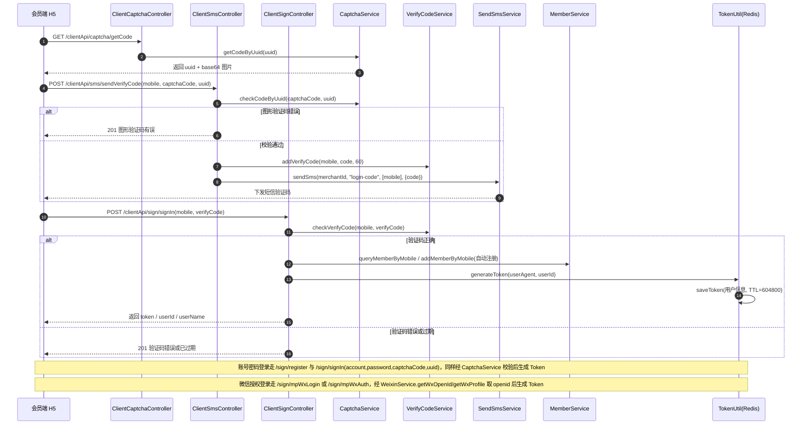
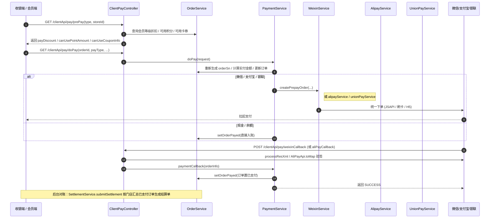
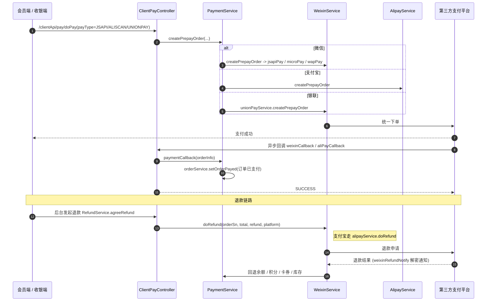
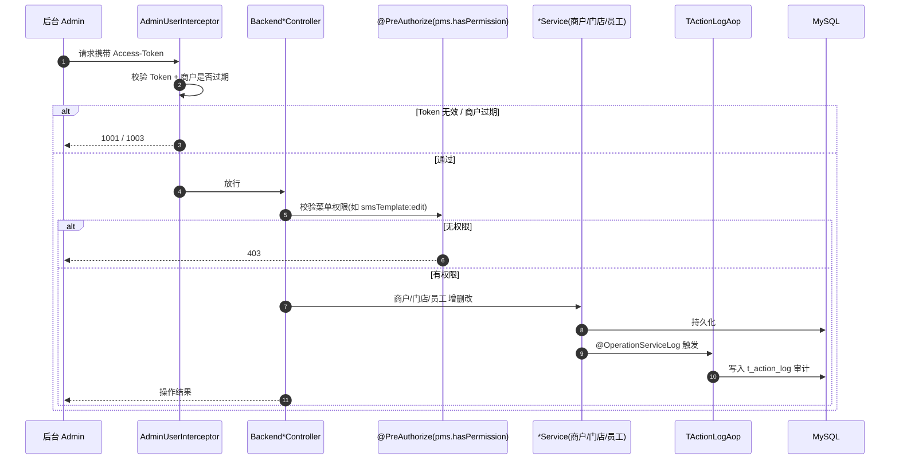

# 02 · 核心业务流程图

> **本文档目的**：用可视化的时序图 / 流程图，帮助客户与实施团队快速理解 bahar 四行业矩阵站（零售 / 汽车 / 餐饮 / 康养）的核心业务调用链路。所有图示均严格依据后端源码中的真实 Controller / Service / 方法命名与调用关系绘制，可作为二次开发与运维排错的索引。

> **阅读约定**
> - 四套后端共用同一份 Java 代码（包名 `com.bahar`），仅 `application.yaml` 中端口 / 库名 / Redis 库序号不同（8081 / 8082 / 8083 / 8084）。
> - 会员端接口统一前缀 `/clientApi/*`；后台管理接口统一前缀 `/backendApi/*`。
> - 鉴权统一通过请求头 `Access-Token`；未带 Token 的 `/clientApi/system/config`、各端 `captcha`、`sms/sendVerifyCode`、支付回调等白名单接口除外。

---

## 1. 会员注册 / 登录时序

> 会员端登录支持三种方式：**短信验证码登录**、**账号密码登录**、**微信授权登录（公众号 / 小程序）**。三者共用图形验证码与短信验证码前置校验，最终统一由 `TokenUtil.generateToken()` 生成 Token 并写入 Redis（`SESSION_USER + token`，有效期 7 天），再随响应返回前端。
>
> ⚠️ **演示用万能验证码（仅部分端）**：经源码核对，**汽车（8082）与餐饮（8083）** 两套后端在短信登录分支**硬编码了万能码 `999999`**（见各自 `ClientSignController.signIn`：`if (verifyCode.equals("999999")) { mtVerifyCode = new MtVerifyCode(); mtVerifyCode.setId(1L); }`，即跳过真实验证码查询直接放行），用于演示时免真实短信即可登录；**零售（8081）与康养（8084）无此逻辑**，必须使用真实下发的随机验证码。正常验证码由 `BizCodeGenerator.getVerifyCode()` 随机生成、落库 `mt_verify_code`，5 分钟过期、同号 2 分钟内不可重发。该万能码属**演示便利**，上线前务必移除（详见第 4 篇「上线建议」）。



---

## 2. 下单 / 买单流程

> 收银端（Electron）与会员端（H5）均可发起下单。核心链路：**购物车 / 下单 → 支付前查询（可用券、积分、会员折扣）→ 发起支付 → 第三方渠道回调 → 订单置为已支付 → 后台结算 / 对账**。



---

## 3. 优惠券领取（前台 `SEND_WAY='front'`）与使用 / 核销

> 优惠券发放方式由 `SendWayEnum` 定义：`backend`（后台发放）、`offline`（线下发放）、`front`（前台领取）。前台领取指会员在 H5 主动领取，由 `CouponService.sendCoupon()` 写入 `mt_user_coupon`；核销由收银端在买单时调用 `CouponService.useCoupon()`，生成 `mt_confirm_log` 核销流水（储值卡核销会回写余额、计次卡累加核销次数）。

```mermaid
flowchart TD
    A[会员端 H5 进入领券中心] --> B[查询可领券列表<br/>CouponListParam.sendWay = 'front']
    B --> C{会员点击领取}
    C --> D[CouponService.sendCoupon(couponId, userId, num, ...)]
    D --> E{券类型判断}
    E -->|优惠券 / 计次卡| F[写入 mt_user_coupon<br/>状态 UNUSED, 生成12位 code]
    E -->|储值卡 PRESTORE| G[UserCouponService.preStore<br/>写入储值余额]
    F --> H[会员卡包可见]
    G --> H

    H --> I[买单时选择卡券]
    I --> J[CouponService.useCoupon(userCouponId, userId, storeId, orderId, amount)]
    J --> K[修改 mt_user_coupon 状态 / 储值余额 / 计次次数]
    K --> L[生成 mt_confirm_log 核销流水]
    L --> M[可选: 发送 confirm-coupon 核销短信]
```

---

## 4. 支付与退款（微信 / 支付宝 / 银联三渠道）

> 支付发起由 `PaymentService.createPrepayOrder()` 按 `payType` 路由到 `WeixinService` / `AlipayService` / `UnionPayService`；回调分别由 `ClientPayController` 的 `weixinCallback` / `aliPayCallback` / `weixinRefundNotify` 接收。退款由售后模块 `RefundServiceImpl.agreeRefund()` 调用微信 / 支付宝退款接口，并同步回退余额、积分、卡券、库存。



---

## 5. 分销 / 佣金（`mt_commission_relation` / `mt_commission_log`）

> 分销员通过分享链接发展下级，建立 `mt_commission_relation` 关系；下级完成支付后，定时任务 `CommissionJob`（开关 `commission.job.switch=1`，每分钟执行）调用 `CommissionLogService.calculateCommission()` 计算提成并写入 `mt_commission_log`；分销员可在会员端查询概览 / 订单并申请提现（`CommissionCashService.withdraw`）。

```mermaid
flowchart TD
    A[分销员分享带 shareId 的链接] --> B[下级点击注册 / 下单]
    B --> C[建立 mt_commission_relation 关系]
    C --> D[下级完成支付 order 状态=SUCCESS]
    D --> E[CommissionJob 定时扫描待分佣订单]
    E --> F[CommissionLogService.calculateCommission(orderId)]
    F --> G[写入 mt_commission_log 佣金记录]
    G --> H[会员端 /clientApi/commission/overview 查看概览]
    H --> I[申请提现 /clientApi/commission/withdraw]
    I --> J[CommissionCashService.withdraw 生成提现单]
```

---

## 6. 后台管理操作（商户 / 门店 / 员工 增删改与权限）

> 后台所有写操作均经 `AdminUserInterceptor` 鉴权（校验 `Access-Token` 与商户有效性），并通过 `@PreAuthorize("@pms.hasPermission('xxx:edit')")` 做方法级 RBAC 校验；关键操作被 `TActionLogAop` 切面织入，自动记录到操作审计表 `t_action_log`。菜单 / 角色 / 权限由 `SourceService`（菜单树）、`DutyService`（角色）、`AccountService`（员工账号）协同管理。



---

## 附：关键源码索引（便于溯源）

| 业务 | 核心类 / 方法 | 路径 |
| --- | --- | --- |
| 图形验证码 | `ClientCaptchaController.getCode` / `CaptchaService.getCodeByUuid` | `module/clientApi/controller/ClientCaptchaController.java` |
| 短信验证码 | `ClientSmsController.sendVerifyCode` / `VerifyCodeServiceImpl.addVerifyCode` | `module/clientApi/controller/ClientSmsController.java` |
| 会员登录注册 | `ClientSignController.signIn/register/mpWxLogin/mpWxAuth` | `module/clientApi/controller/ClientSignController.java` |
| Token 生成与校验 | `TokenUtil.generateToken/saveToken/getUserInfoByToken` | `common/util/TokenUtil.java` |
| 支付发起 | `ClientPayController.doPay/prePay` / `PaymentServiceImpl.doPay` | `module/clientApi/controller/ClientPayController.java` |
| 微信支付 | `WeixinServiceImpl.createPrepayOrder/jsapiPay/microPay/wapPay` | `common/service/impl/WeixinServiceImpl.java` |
| 支付宝 / 银联 | `AlipayService` / `UnionPayService` 及各自 impl | `common/service/*` |
| 支付回调 | `ClientPayController.weixinCallback/aliPayCallback/weixinRefundNotify` | 同支付发起 |
| 退款 | `RefundServiceImpl.agreeRefund` → `weixinService.doRefund/alipayService.doRefund` | `common/service/impl/RefundServiceImpl.java` |
| 优惠券 | `CouponServiceImpl.sendCoupon/useCoupon` / `SendWayEnum` | `common/service/impl/CouponServiceImpl.java` |
| 分销佣金 | `CommissionJob.dealOrder` / `CommissionLogService.calculateCommission` | `module/schedule/CommissionJob.java` |
| 后台鉴权 | `AdminUserInterceptor` / `ClientUserInterceptor` / `WebConfig` | `common/web/*` |
| 操作审计 | `TActionLogAop` | `common/aspect/TActionLogAop.java` |
