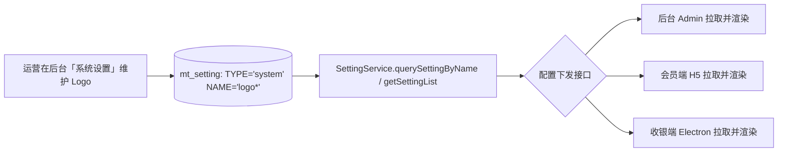

# 05 · Logo 展示与后台配置方案

> **本文档目的**：分析 bahar 三端（后台 Admin / 会员端 H5 / 收银端 Electron）当前 Logo 的展示位置与问题，并给出一套**可落地、可后台统一配置**的设计方案。所有引用均来自真实源码文件。

> **实施进度（2026-10-13）**：已落地其一 —— **会员端首页顶部门店条新增门店 Logo 展示位**。
> - 后端：`ClientSystemController#config` 将 `mt_store.LOGO`（相对路径）拼成完整可访问 URL（`images.upload.url` 前缀）后，随 `storeInfo.logo` 一并返回，避免前端按 H5 页面相对路径解析 404。
> - 前端：`components/page/location/index.vue` 在门店名前渲染圆形 Logo（`v-if="storeInfo.logo"`，`mode="aspectFill"`）。
> - 数据来源：即后台「门店管理」中该门店的 Logo 字段（`mt_store.LOGO`），无需新增配置表；效果见 `01-界面截图/会员端/01-首页.png`。
>
> 文中「三端统一从后台配置读取图片 Logo」的完整方案仍为规划，其余两端尚未实施。

---

## 一、三端 Logo 现状分析（基于真实代码）

### 1.1 后台 Admin（Web，由后端 jar 在 `/admin/index.html` 提供）

| 项 | 现状 | 证据 |
| --- | --- | --- |
| 品牌呈现 | **纯文字**，无图片 Logo | `deploy/admin/index.html`：登录页 `.login-title`（"bahar 会员营销管理系统"）、侧边栏 `.brand`（`<i>` 图标 + 文本） |
| 标题来源 | 由 `config.js` 注入的 `window.__BAHAR_ADMIN_TITLE__` 覆盖 `document.title`，四套共用一份静态资源靠配置区分 | `deploy/admin/index.html` 内联脚本 `if (window.__BAHAR_ADMIN_TITLE__) document.title = ...` |
| 疑似 Logo 字段 | `deploy/admin/js/modules.js:1022` 的 `prop:'logo'` 实为「**商户封面**」业务字段，非应用 Logo | 业务列表封面列 |

### 1.2 会员端（uniapp H5）

| 项 | 现状 | 证据 |
| --- | --- | --- |
| 登录页 Logo | `pages/login/index.vue` → `pages/login/components/main.vue` 中**未绑定图片 Logo**（仅验证码 `<image :src="captcha">`） | 全量检索仅 `.png` 命中为验证码图 |
| 「LOGO」字样来源 | 在 `pages/login/index.vue`、`pages/user/setting.vue`、`store/modules/user.js`、`utils/request/index.js` 中的 grep 命中实为方法名 `Logout`（`logo` 子串），**并非 Logo 配置** | grep 一致性核对 |
| 品牌展示 | 依赖后端配置项与文字 / 主题，未绑定独立图片 Logo | 同上 |

### 1.3 收银端（Electron 桌面）

| 项 | 现状 | 证据 |
| --- | --- | --- |
| 侧边栏 Logo | `Sidebar/logo.vue` 中 `data(){ return { title: "bahar" } }` —— **硬编码文本**，无图片 | `baharCashier/src/renderer/layout/components/Sidebar/logo.vue:25` |
| 标题栏 Logo | `components/title/index.vue` 有注释「软件 logo 预留位置」+ `<svg-icon icon-class="electron-logo">` 占位 | `baharCashier/src/renderer/components/title/index.vue:4-6` |
| 系统名 | `views/login|home|setting/index.vue` 的 `systemName` 来自 `process.env.userConfig.SYSTEM_NAME` | 多处 `process.env.userConfig.SYSTEM_NAME` |
| 落地页 Logo | `components/LandingPage.vue:80` `logo: require("@/assets/logo.png")` —— **打包内联资源**，无法后台替换 | `baharCashier/src/renderer/components/LandingPage.vue` |

### 1.4 现存问题（归纳）

1. **硬编码**：收银端 `Sidebar/logo.vue` 的 `"bahar"`、落地页 `require("@/assets/logo.png")` 均为代码 / 打包内联，改 Logo 需改代码并重新打包。
2. **各端不一致**：后台为文字品牌、收银端为内联 PNG、会员端无独立 Logo —— 三端视觉无法统一。
3. **无法后台统一配置**：当前 `mt_setting` 无 Logo 配置项，运营人员无法在后台一键换 Logo。

---

## 二、设计方案（仅方案，不改动代码）

### 2.1 总体思路

在后台 `mt_setting` 增加 **系统级 Logo 配置**，复用现有 `SettingService` 读取能力（与短信、积分、订阅消息等完全一致），由前后端约定的配置下发接口返回 Logo 地址；三端启动时拉取并渲染。



### 2.2 数据约定（建议）

在 `mt_setting` 增加一行（可按端拆分多行）：

| TYPE | NAME | VALUE（示例） | 说明 |
| --- | --- | --- | --- |
| `system` | `logo` | `https://cdn.example.com/logo.png` | 全局默认 Logo（完整可访问 URL，由 `images.upload.url` 或 OSS 域名拼接） |
| `system` | `logo_admin` | `...` | 后台专用（可选） |
| `system` | `logo_member` | `...` | 会员端专用（可选） |
| `system` | `logo_cashier` | `...` | 收银端专用（可选） |

> 上传入口可直接复用现有「文件上传」能力（落 `images.root` 或 OSS），保存后回填上述 value。

### 2.3 最小实现示意

**① 后端读取（复用既有能力，无需新接口）**

```java
// 现有能力即可返回，无需新增方法
MtSetting logoSetting = settingService.querySettingByName(
        merchantId, SettingTypeEnum.SYSTEM.getKey(), "logo");
String logoUrl = (logoSetting != null) ? logoSetting.getValue() : "";
// 由会员端配置下发接口（如已在 ClientUserInterceptor 白名单中的 /clientApi/system/config）
// 或后台 setting 接口，将 logoUrl 一并返回
```

**② 后台 Admin（读取位置）**

- 在 `deploy/admin/index.html` 登录区 / 侧边栏 `.brand` 增加 ``；
- 在 `config.js` 主题注入处一并注入 `window.__BAHAR_ADMIN_LOGO__`，启动时赋值给 `document` 或 Vue 全局状态，`api.js` 拉取系统配置后覆盖。

**③ 会员端（读取位置）**

- `store/modules/user.js`：初始化 / 登录成功后写入 `logo` 状态；
- `pages/login/index.vue` 与 `pages/user/setting.vue`：绑定 `<image :src="logo"></image>`（替代当前纯文字 / 主题）。

**④ 收银端（读取位置）**

- `Sidebar/logo.vue`：将硬编码 `title: "bahar"` 改为渲染 ``，`logoUrl` 取自 `process.env.userConfig.LOGO` 或运行时配置接口；
- `components/LandingPage.vue`：将 `require("@/assets/logo.png")` 改为动态地址 `logoUrl`。

### 2.4 「后台可配置项」示意表

| 配置项 | 类型 | 默认值 | 后台入口（建议） | 影响范围 |
| --- | --- | --- | --- | --- |
| 系统 Logo（全局） | 图片 URL | 空 | 系统设置 → 基础信息 → Logo | 三端统一默认 |
| 后台 Logo | 图片 URL | 复用全局 | 同上（按端覆盖） | 仅后台 Admin |
| 会员端 Logo | 图片 URL | 复用全局 | 同上（按端覆盖） | 仅会员端 H5 |
| 收银端 Logo | 图片 URL | 复用全局 | 同上（按端覆盖） | 仅收银端 Electron |
| 系统名称（已有） | 文本 | `bahar` | `process.env.userConfig.SYSTEM_NAME` / 配置中心 | 收银端标题栏 |

---

## 三、收益与实施建议

- **统一品牌**：三端 Logo 一处配置、处处生效，避免视觉割裂。
- **运营自助**：市场 / 运营人员可在后台直接换 Logo，无需研发介入与重新打包。
- **低风险**：完全复用既有 `mt_setting` + `SettingService` 体系，不引入新表与新鉴权链路。
- **落地步骤**：① 后台「系统设置」增加 Logo 上传与保存（写 `mt_setting`）；② 配置下发接口补充 `logo` 字段；③ 三端按 2.3 读取位置绑定渲染；④ 清理收银端硬编码 `title` 与 `require` 内联资源。
